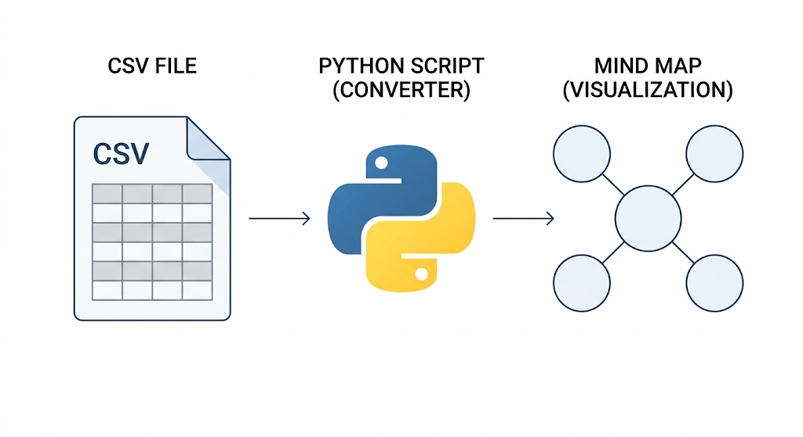
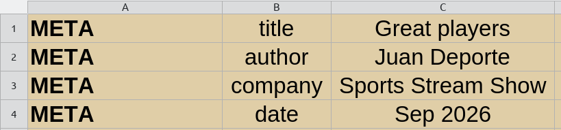
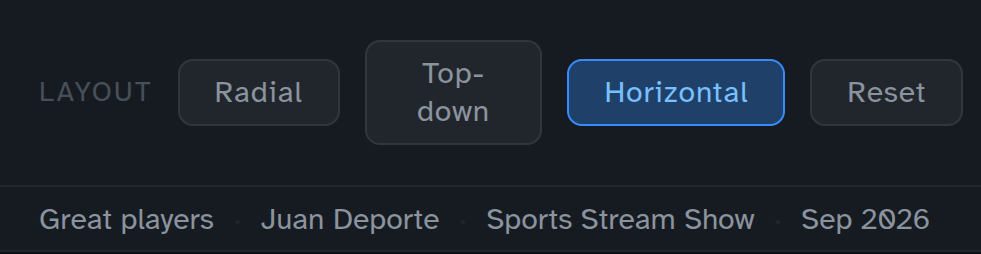
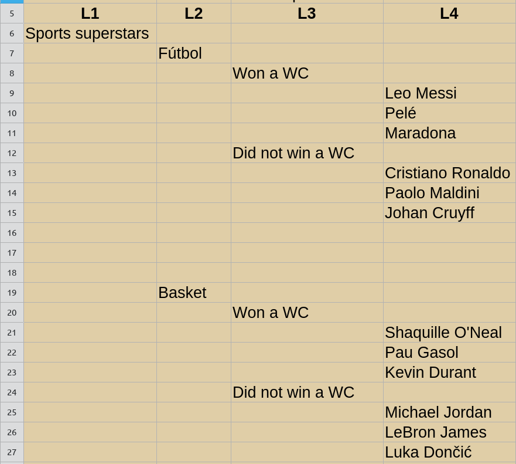
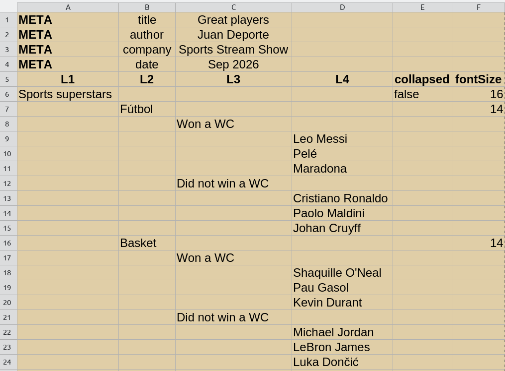
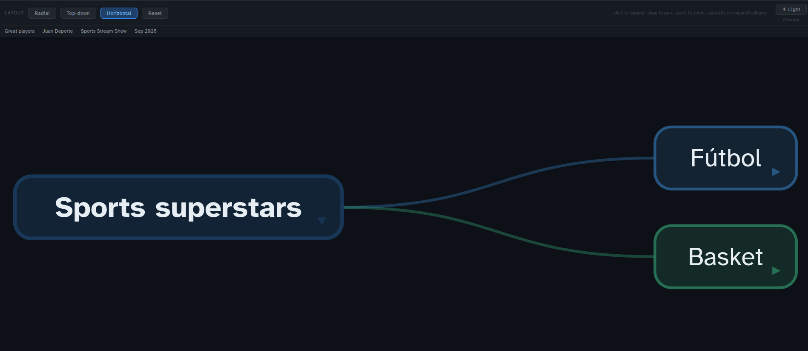
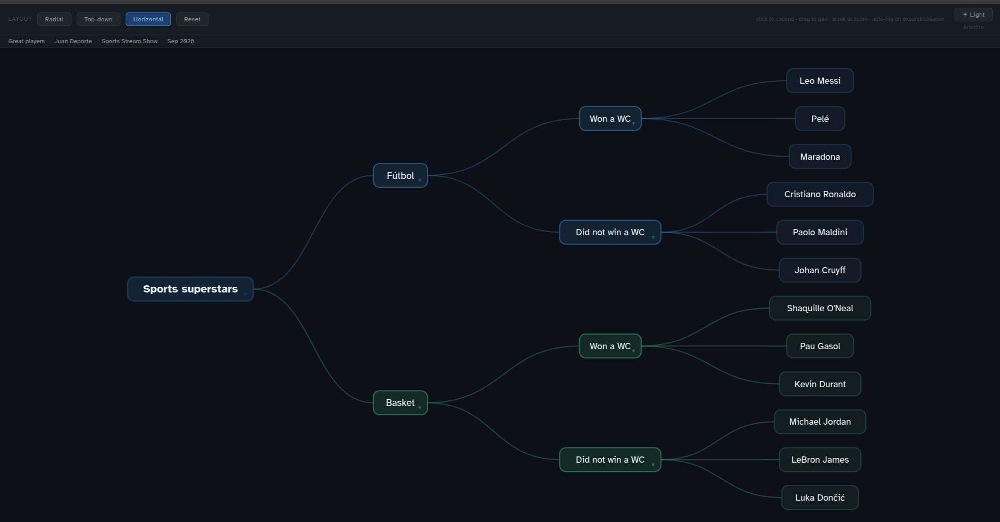

# Arbolito

**See it live here**: [arbolito](https://rodrigo-j-goncalves.github.io/serve/arbolito/arbolito_mindmap.html)

- Generate an interactive, animated mind map from a simple CSV spreadsheet.
- The output is a self-contained HTML file suitable for embedding in Quarto RevealJS slides (or in any other HTML-based context).

---



---

## Files

| File | Purpose |
| --- | --- |
| `arbolito.py` | Python script that reads the CSV and writes the HTML |
| `arbolito_mindmap.csv` | Your content (edit this) |
| `arbolito_mindmap.html` | Generated output (do not edit directly) |

---

## Requirements

Python 3.7+ with no extra dependencies (uses only the standard library).
An internet connection is required at viewing time to load D3.js and the Atkinson Hyperlegible font from CDN.

---

## Usage

```bash
python arbolito.py
```

This reads `arbolito_mindmap.csv` and writes `arbolito_mindmap.html` in the same directory.

### Options

- You can specify `input` and `output` files:

    ```bash
    python arbolito.py --input mindmap.csv --output mindmap.html
    ```

- You can also save the intermediate JSON tree for inspection:

    ```bash
    python arbolito.py --input mindmap.csv --output mindmap.html --save-json tree.json
    ```

---

## CSV Format

Open or create your CSV in any spreadsheet application (e.g. LibreOffice Calc, MS Excel, etc.) or a plain text editor.

### How to organize your CSV file

#### META Rows

You can add `META` rows to include information (eg Title, Author, University/Company, Date, etc.). This information will be shown on the mindmap. `META` rows are optional, and there is no maximum (but it won't look nice if you add too much text!).

Here I show an example where I include a `title`, `author`, `company`, and `date`. These names are just for your CSV file, and are not shown on the mindmap (you can add any other!). The mindmap shows the values only (third column)



And it looks like this, on the top-left corner of the mindmap:



#### Columns

The columns are organized as 'Levels'. A level is a box (node). `L1` is the 'grandparent' or first level (in the simple example: 'Sports superstars'), `L2` is the 1st 'parent' (in the example: the name of the sport), `L3` is the 'child' (in the example: whether the player won a WC or not), etc.



As you can see, `L1`, `L2`, `L3`, ... are hierarchy levels. **You can add as many as needed**. Each node belongs to the level column where its name is written; all other level columns on that row are left empty.

**Visualization options**

Two more columns define how the mindmap is shown:

- `collapsed` — Whether the node is collapsed in the initial view. Write `false` to start expanded. Leave blank to use the default (collapsed).
- `fontSize` — Font size in pixels for this node's label. Leave blank to use the default (13px).

### A simple, full example

This CSV structure:



Produces a tree like this:

```text
    Sports superstars
      ├── Fútbol
      │   ├── Won a WC
      │   │   ├── Leo Messi
      │   │   ├── Pelé
      │   │   └── Maradona
      │   └── Did not win a WC
      │       ├── Cristiano Ronaldo
      │       ├── Paolo Maldini
      │       └── Johan Cruyff
      └── Basket
          ├── Won a WC
          │   ├── Shaquille O'Neal
          │   ├── Pau Gasol
          │   └── Kevin Durant
          └── Did not win a WC
              ├── Michael Jordan
              ├── LeBron James
              └── Luka Dončić

```

which results in this mindmap:

**Initial view**




**Fully expanded**




### **See it live here!**
- [This is the CSV file](https://rodrigo-j-goncalves.github.io/serve/arbolito/arbolito_mindmap_simpleExample.csv)
- [See the rendered mindmap](https://rodrigo-j-goncalves.github.io/serve/arbolito/arbolito_mindmap_simpleExample.html)

### Rules

- The root node must be in the `L1` column.
- A node at level `Ln` must appear after a node at level `L(n-1)` — you cannot skip levels.
- Blank rows are ignored.
- `collapsed` = false means the node's children are visible on load. Any other value or blank means collapsed.
- `fontSize` value affects only the label of that specific node. Child nodes are not affected.

---

## Interacting with the Mind Map

| Action | Effect |
| --- | --- |
| Click a node | Expand or collapse its children |
| Expand / collapse | Viewport auto-fits to show all visible nodes |
| Drag | Pan the view (disables auto-fit) |
| Scroll / pinch | Zoom in and out (disables auto-fit) |
| Change layout | Resets auto-fit and re-fits to the new layout |
| Layout buttons | Switch between Radial, Top-down, and Horizontal layouts |

---

## Embedding in Quarto RevealJS (or on your website!)

Save `arbolito_mindmap.html` next to your `.qmd` file, then insert a slide like this:

```markdown
## My Mind Map

<iframe src="arbolito_mindmap.html" width="100%" height="600px" frameborder="0"></iframe>
```

You can adjust the `height` value to fit your slide dimensions.

## License & Credits

- MIT Rodrigo J. Gonçalves
- I _claudeveloped_ this :p (Claude Code, claude-sonnet-4-6)
